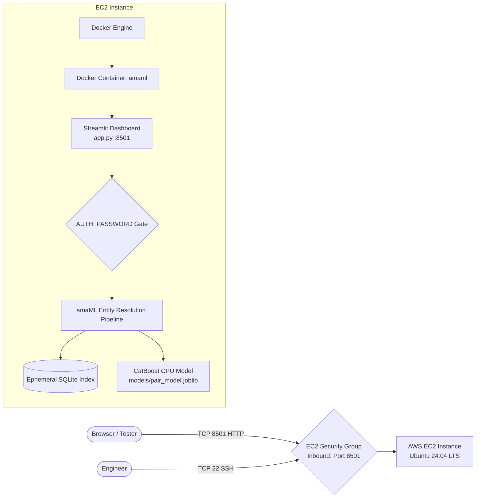

# AWS EC2 Docker Deployment Guide — amaML Entity Resolution

This guide provides instructions for deploying the **amaML Entity Resolution** application on a single AWS EC2 virtual machine running **Ubuntu 24.04 LTS** using Docker.

Repository: `https://github.com/NirSen117/amaML.git`

---

## Architecture Overview



---

## 1. AWS Account Prerequisites & Instance Sizing

### Prerequisites
- An active AWS account.
- An IAM user with EC2 management permissions.
- An SSH key pair (`.pem`) downloaded to your local computer.

### Recommended Instance Specifications
- **Operating System**: **Ubuntu Server 24.04 LTS** (64-bit x86_64).
- **Instance Type**: 
  - *Testing & Synthetic Benchmarks*: `t3.large` (2 vCPU, 8 GB RAM) or `t3.medium` (2 vCPU, 4 GB RAM). Choose a Free Tier or credit-eligible instance where available; verify current eligibility in the AWS Console.
  - *Full Scale Evaluation*: `c6i.xlarge` (4 vCPU, 8 GB RAM) or `m6i.xlarge` (4 vCPU, 16 GB RAM) for large-scale candidate generation.
- **Root Storage (EBS)**: 25–30 GB `gp3` (General Purpose SSD with 3,000 baseline IOPS).

### Why GPU is NOT Required
- **CPU-Based Inference**: The pre-trained CatBoost matching model (`models/pair_model.joblib`, 635 KB) executes feature scoring on CPU.
- **SQLite Blocking**: Candidate blocking relies on an inverted SQLite index with clustered sorting, which is CPU- and disk-I/O bound.
- **Cost Efficiency**: GPU instances (e.g., `g4dn.xlarge`) incur higher hourly charges, consume testing credits quickly, require proprietary NVIDIA drivers, and provide no operational benefit for application startup or inference.

---

## 2. Security Group Configuration

Configure an EC2 Security Group with the **minimum required inbound access**:

| Type | Protocol | Port Range | Source | Purpose |
| :--- | :--- | :--- | :--- | :--- |
| **SSH** | TCP | `22` | **My IP** (`<your-ip>/32`) | Secure terminal administration |
| **Custom TCP** | TCP | `8501` | **My IP** (`<your-ip>/32`) | Streamlit web dashboard testing |

> [!WARNING]
> **Never open SSH (port 22) to `0.0.0.0/0` (Anywhere)**. Opening port 22 to the public internet leaves your instance vulnerable to unauthorized access and automated brute-force attacks. Always select **My IP** in the AWS console dropdown.

> [!NOTE]
> If additional team members require access, add specific `/32` IP rules for their individual addresses. If the dashboard is later published to external stakeholders, place it behind a reverse proxy (e.g., Nginx or Caddy) with SSL/TLS encryption (HTTPS on port 443).

---

## 3. Connecting to the EC2 Instance

From your local terminal:

```bash
# 1. Restrict private key permissions
chmod 400 your-key.pem

# 2. Connect to Ubuntu 24.04 instance
ssh -i "your-key.pem" ubuntu@<EC2-PUBLIC-IP>
```

Alternatively, use **EC2 Instance Connect** directly from the AWS Console.

---

## 4. Installing Docker on Ubuntu 24.04 LTS

Execute the following commands on the Ubuntu 24.04 EC2 instance to install Docker Engine:

```bash
# 1. Update system package index
sudo apt-get update -y
sudo apt-get install -y ca-certificates curl gnupg

# 2. Add Docker's official GPG key
sudo install -m 0755 -d /etc/apt/keyrings
curl -fsSL https://download.docker.com/linux/ubuntu/gpg | sudo gpg --dearmor -o /etc/apt/keyrings/docker.gpg
sudo chmod a+r /etc/apt/keyrings/docker.gpg

# 3. Add Docker repository for Ubuntu 24.04 (noble)
echo \
  "deb [arch=$(dpkg --print-architecture) signed-by=/etc/apt/keyrings/docker.gpg] https://download.docker.com/linux/ubuntu \
  $(. /etc/os-release && echo "$VERSION_CODENAME") stable" | \
  sudo tee /etc/apt/sources.list.d/docker.list > /dev/null

# 4. Install Docker Engine, CLI, and Containerd
sudo apt-get update -y
sudo apt-get install -y docker-ce docker-ce-cli containerd.io docker-buildx-plugin docker-compose-plugin

# 5. Start and enable Docker service
sudo systemctl enable --now docker

# 6. Allow the ubuntu user to run Docker without sudo
sudo usermod -aG docker ubuntu
newgrp docker
```

Verify installation:
```bash
docker --version
```

---

## 5. Cloning Repository & Building the Docker Image

```bash
# 1. Clone the repository
git clone https://github.com/NirSen117/amaML.git
cd amaML

# Switch to the deployment branch if working from a deployment branch
git checkout deployment/amaML-ec2

# 2. Build the Docker container image
docker build -t amaml .
```

---

## 6. Running the Streamlit Container

### Setting AUTH_PASSWORD Securely
Never hardcode passwords or AWS credentials inside source code or commit them to Git. Pass the password at runtime via environment variable injection.

### Start the Container:
```bash
docker run -d \
  --name amaml \
  --restart unless-stopped \
  -p 8501:8501 \
  -e AUTH_PASSWORD="choose_a_strong_password_here" \
  amaml
```

### Alternatively, using a local `.env` file on the instance:
```bash
# Create local .env on the EC2 host (excluded by .gitignore)
cat <<EOF > .env
AUTH_PASSWORD=choose_a_strong_password_here
PORT=8501
EOF

# Run container with environment file
docker run -d \
  --name amaml \
  --restart unless-stopped \
  -p 8501:8501 \
  --env-file .env \
  amaml
```

---

## 7. Verifying Health & Accessing the Dashboard

### 1. Verify Health Check Endpoint
Query Streamlit's built-in health endpoint:
```bash
curl -i http://localhost:8501/_stcore/health
```
Expected response:
```http
HTTP/1.1 200 OK
content-type: text/plain; charset=utf-8
content-length: 2

ok
```

### 2. Open the Dashboard in Your Browser
Navigate to:
```text
http://<EC2-PUBLIC-IP>:8501
```

1. Enter your `AUTH_PASSWORD` in the sidebar and click **Log In**.
2. Upload test TSV files or specify a server path.
3. Click **Run Entity Resolution** to generate `matching_results.tsv` and `candidate_pairs.tsv`.
4. Download the resulting artifacts directly from the browser.

---

## 8. Managing Container Lifecycle

### View Live Container Logs
```bash
docker logs -f amaml
```

### Stop the Container
```bash
docker stop amaml
```

### Start the Container
```bash
docker start amaml
```

### Restart the Container
```bash
docker restart amaml
```

### Remove the Container
```bash
docker rm -f amaml
```

---

## 9. Dataset Handling Guidelines

> [!IMPORTANT]
> The private challenge competition dataset must **NEVER** be committed to Git or baked into the Docker image. Both `.gitignore` and `.dockerignore` strictly exclude `dataset/`.

The application supports two testing modes:

### Option A: Small Files (Browser Upload)
- On the **Run Prediction** tab, select **Upload TSV Files (Drag & Drop)**.
- Upload `test_source1.tsv`, `test_source2.tsv`, and `test_source3.tsv`.
- Files are streamed chunk-by-chunk directly into an ephemeral `tempfile.TemporaryDirectory()` and discarded automatically after prediction.

### Option B: Large Production Files (Mounted Host Path)
For larger files, avoid browser uploads:
1. Transfer datasets to a directory on the EC2 host (e.g. `/home/ubuntu/dataset`):
   ```bash
   # Example: Sync from private S3 bucket on EC2
   aws s3 sync s3://my-private-amaml-bucket/dataset /home/ubuntu/dataset
   ```
2. Mount the host directory as a read-only volume into the container:
   ```bash
   docker run -d \
     --name amaml \
     --restart unless-stopped \
     -p 8501:8501 \
     -v /home/ubuntu/dataset:/app/dataset:ro \
     -e AUTH_PASSWORD="your_secure_password" \
     amaml
   ```
3. In the dashboard UI, choose **Server-Side Path** and set the directory path to `dataset` (or `dataset/test`).

---

## 10. AWS Cost Safety

To conserve AWS credits and prevent unexpected charges:

1. **Start with CPU, Not GPU**: Do not launch GPU instances for testing. Standard CPU instances cost significantly less and are completely sufficient for this pipeline.
2. **Avoid Unnecessarily Large Instances**: Begin testing with `t3.large` or `c6i.large`.
3. **Stop Instances When Inactive**: Instances incur hourly compute charges while running. Stop the instance when testing pauses:
   ```bash
   # From local terminal:
   aws ec2 stop-instances --instance-ids <YOUR-INSTANCE-ID>
   ```
   Or select **Instance State ➔ Stop Instance** in the AWS Console. Stopped instances incur no compute charges.
4. **Terminate Unused Instances**: When testing is complete, terminate the instance to release attached storage:
   ```bash
   # From local terminal:
   aws ec2 terminate-instances --instance-ids <YOUR-INSTANCE-ID>
   ```
   Or select **Instance State ➔ Terminate Instance** in the AWS Console.
5. **Set Up an AWS Budget & Billing Alert**:
   - Go to **AWS Billing ➔ Budgets**.
   - Create a budget alert (e.g., at $20 and $50).
   - Configure email notifications.
6. **Avoid Unnecessary Paid Infrastructure**:
   - Do **NOT** allocate an Elastic IP unless strictly needed (unattached Elastic IPs incur hourly fees).
   - Do **NOT** provision Application Load Balancers or NAT Gateways for initial single-instance testing.
   - Use a single `gp3` root volume (25–30 GB) with default baseline IOPS.
7. **No Hardcoded Credentials**:
   - Never store AWS Access Keys, Secret Keys, or session tokens in the repository, Dockerfile, or image.
